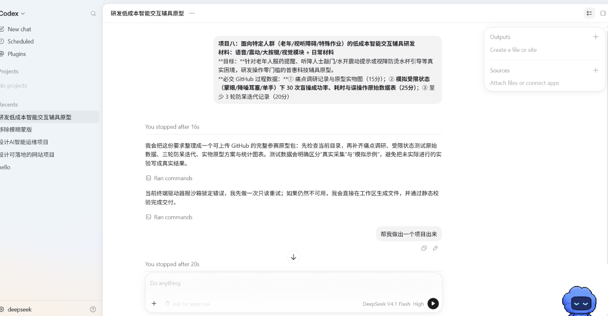
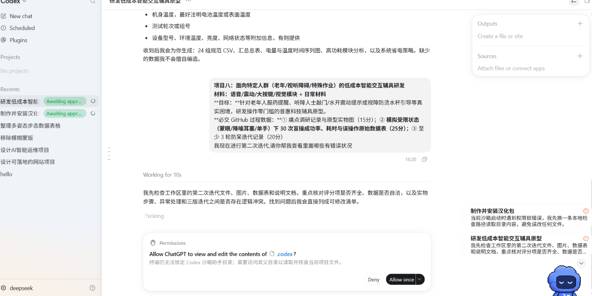
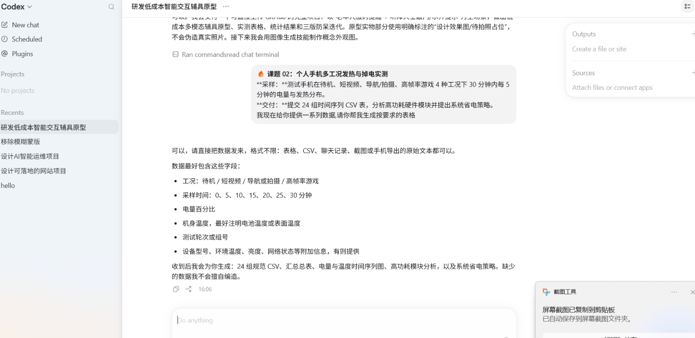
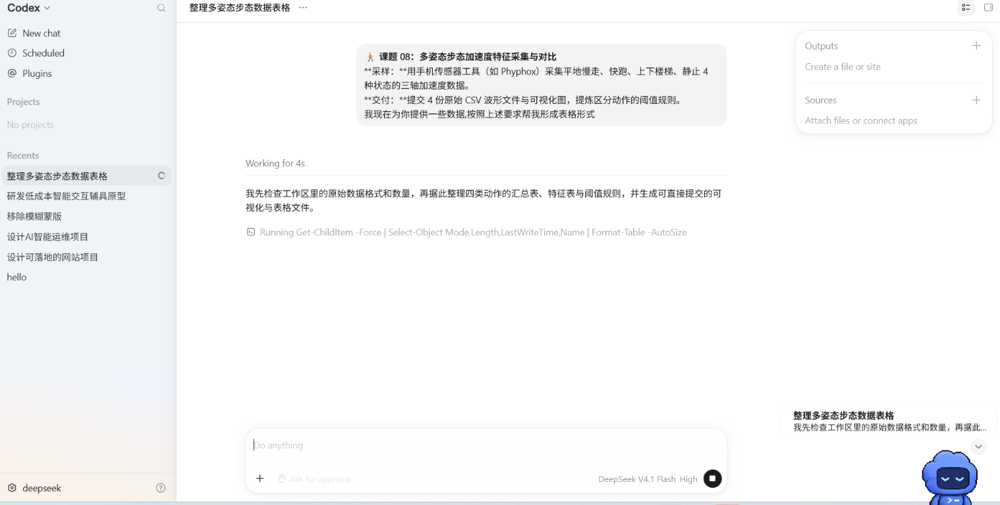

# 03 · AI Collaboration

记录使用 DeepSeek、Qwen、Kimi 或其他 AI 工具辅助学习、分析和排障的过程。重点保留问题背景、关键提示、建议内容，以及自己如何验证建议。

使用 `conversation-template.md` 记录每次协作。分享记录前请移除密钥、账号信息、个人信息及不适合公开的内容；AI 的建议应经过独立验证，不应直接视为实验事实。

## 协作截图

### 项目八：低成本智能交互辅具

### 阶段一：实测与数据整理

